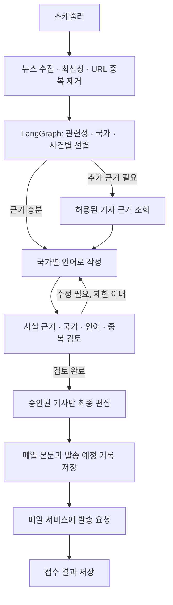

# 02. 시스템 구조 제안

이 문서는 기획 수준의 설계안이다. 언어, 모듈명과 라이브러리 세부 구현은 사용자와 개발 Codex가 리뷰하며 결정한다.

## 에이전트와 일반 프로그램의 역할

| 일반 프로그램 | AI 에이전트 |
|---|---|
| 예약 실행, 시간대 계산 | 기사 관련성과 중요도 판단 |
| RSS 수집, 날짜·URL 정규화 | 사건의 관련 국가 판단 |
| 명확한 중복 URL 제거 | 같은 사건의 여러 보도 구분 |
| 허용된 소스·조회 횟수 제한 | 근거 부족 시 추가 조회 선택 |
| 메일 템플릿과 발송 | 요약·중요성 작성과 근거 검토 |
| 발송 기록·재시도·실패 상태 관리 | 수정 또는 기사 제외 판단 |

LangGraph를 사용한다는 사실 자체가 에이전트성을 보장하지 않는다. 모델이 근거를 보고 추가 행동을 선택하고 결과에 따라 수정하는 경로가 핵심이다. 처음부터 여러 에이전트로 나눌 필요는 없다.

## 제안 흐름

LangSmith는 선별·조회·작성·검토의 실행과 모델 호출을 추적한다. 수신자 이메일, 인증정보와 발송 비밀키는 그래프 상태와 추적 입력에 넣지 않는다.

## 모듈 경계

| 모듈 책임 | 입력 → 출력 |
|---|---|
| 설정 | 수신자·시간대·예산·서비스 설정 → 검증된 설정 |
| 소스 관리·수집 | 소스 목록·기간 → 기사 후보와 수집 오류 |
| 전처리 | 기사 후보 → 날짜·URL·언어가 정리된 후보 |
| 편집 그래프 | 후보·과거 발송 이력 → 승인된 기사와 선정/제외 사유 |
| 메일 렌더링 | 승인 기사 → HTML·텍스트 |
| 발송 서비스 | 저장된 메일 → 접수 성공·명확한 실패·불확실한 결과 |
| 저장소 | 기사·브리핑·발송 상태 → 재사용·중복 방지 이력 |
| 스케줄러 | 현지 시각·당일 기록 → 생성/발송 실행 여부 |

편집 그래프 안에서 메일 발송을 직접 수행하지 않는 구성이 좋다. 초안 생성과 실제 발송을 분리해야 재검토·재시도 시 외부 발송이 반복되지 않는다.

## 필요한 데이터

- **기사:** 원문 ID/URL, 매체, 원문 언어, 제목, 발행 시각, 수집 시각, RSS 제공 내용, 추가 근거, 접근 결과
- **선정 결과:** 기사 ID, 국가와 이유, 주제, 중요도 근거, 사건 식별값, 추가 확인 필요 여부
- **브리핑 항목:** 기사 참조, 작성 언어, 제목, 요약, 중요성, 근거 참조, 검토 결과
- **브리핑 발행본:** 영국 현지 날짜, 수집 기간, 생성 시각, 본문, 소스 누락 안내
- **발송 기록:** 고유 발행본/수신자 식별값, 상태, 시도 횟수, 서비스 접수 ID, 오류 종류

자료에 없는 정보는 모델의 사전 지식으로 보충하지 않는다. ‘직접 인용 문자열이 원문에 존재함’은 전체 요약의 정확성을 증명하지 못하므로 검증 수단을 구분한다.

## 비용을 제한하는 기본안

- 하루 한 번 개인용 브리핑 생성
- 정해진 소스 목록에서 우선 수집
- 소스당 후보 수 제한: 기존 초안 12개
- 추가 본문 조회 제한: 기존 초안 총 3개
- 수정 반복 제한: 기존 초안 1회
- 실패 재시도 제한: 기존 초안 당일 3회
- 준비된 본문은 메일 실패 시 재사용
- 호출 수·토큰·실행 시간·실제 모델 요금으로 비용 측정

위 수치는 확정 예산이 아니다. 고정 월 금액을 약속하지 않으며, 출력 토큰 제한과 재시도 제한만으로 금액 상한이 보장되는 것도 아니다. 예산을 정한 뒤 모델·검색·관측·서버 비용을 함께 검토한다.

## 저장과 배포

초안은 단일 worker + SQLite + 영구 디스크를 사용한다. 이 방식을 쓰려면 재시작·재배포 후에도 같은 기록을 읽고, 여러 worker가 동시에 발송하지 않도록 해야 한다. 다른 서버 구조를 선택하면 공유 DB와 동시 실행 제어를 다시 설계한다.

Render·Docker는 참고 구현에 포함된 선택지다. 무료 운영이나 사용자 승인이 확인된 서비스로 취급하지 않는다. 계정 연결만으로 배포 검증이 완료되는 것도 아니다.
