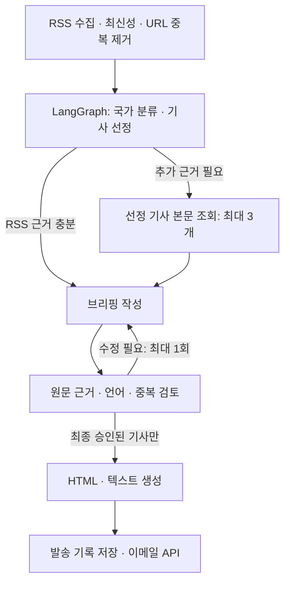

# Yumi의 IT · AI 모닝 브리핑

**현재 상태: 구현 및 로컬 검증 완료, 서버 미배포, 실제 AI·메일 발송 미검증.** 로컬 Docker 데몬이 실행 중이지 않아 컨테이너 빌드는 확인하지 못했습니다.

매일 영국 현지 오전 8시에 실행해 `yumi.heo.01@gmail.com` 한 주소에만 보내는 개인용 프로젝트입니다. 서버에서 실행하므로 개인 컴퓨터를 켜둘 필요가 없습니다. 뉴스 조사 시간이 있어 실제 도착은 오전 8시보다 수 분 늦을 수 있습니다. 메일 서비스가 접수한 뒤의 받은편지함 도착은 서비스와 수신 필터에 따라 달라집니다.

## 브리핑 구성

| 섹션 | 작성 언어 | 수집 대상 |
|---|---|---|
| United Kingdom | 영어 | 영국에 직접 관련된 IT·AI 사건 |
| United States | 영어 | 미국에 직접 관련된 IT·AI 사건 |
| 대한민국 | 한국어 | 한국에 직접 관련된 IT·AI 사건, 한국어 주요 언론사만 |

국가별 최대 3개이며, 근거가 부족하거나 관련 소식이 적으면 개수를 채우지 않습니다. 기사마다 요약, 중요성, 매체, 발행 시각, 원문 링크를 제공합니다. 발행 시각은 UTC로 표시합니다. 사건 발생 시점과 기사 발행 시점은 다를 수 있습니다.

첫 실행은 직전 24시간, 이후에는 마지막 발송본 수집 종료 시점 이후의 기사를 대상으로 합니다. 장기 중단 후에는 최대 72시간까지만 복구합니다. 날짜 없는 기사와 미래 시각 기사는 제외합니다.

## 사용하는 소스

`sources.json`에서 수정할 수 있습니다. 모두 구현 시점에 HTTP 200과 RSS 항목 응답을 확인했습니다. 피드 응답 성공이 매일 각 나라의 뉴스를 충분히 확보한다는 뜻은 아닙니다.

- BBC Technology
- The Guardian Technology
- CNBC Technology
- NPR Technology
- 연합뉴스 산업: IT·AI 관련 키워드로 1차 필터
- 한겨레 과학: IT·AI 관련 키워드로 1차 필터
- SBS 경제: IT·AI 관련 키워드로 1차 필터

한국 영문 매체, 개인 블로그, 커뮤니티는 포함하지 않습니다. 매체의 국적 대신 사건의 직접 관련 국가를 모델이 판단합니다. 분류 오류는 실제 운영 데이터를 보며 개선해야 합니다. 피드의 최근 항목 수와 한국어 키워드 필터 때문에 일부 기사를 놓칠 수 있습니다.

## 에이전트 구조



LangGraph `StateGraph`의 조건부 경로로 모델이 추가 조회 여부와 수정 여부를 결정합니다. 추가 조회는 검색 엔진 전체 검색이 아니라 **이미 수집한 기사 중 모델이 고른 URL의 본문 확인**입니다. robots.txt에서 허용한 공개 본문만 조회하며 로그인·유료벽을 우회하지 않습니다. 접근 불가 시 RSS 근거만 사용하고 표시합니다. RSS 내용만으로 뒷받침할 수 없는 기사는 제외하도록 지시합니다.

모델의 기초 선별·작성·검토는 보통 3회, 수정하면 5회 호출됩니다. 출력은 호출당 최대 5,000토큰, 호출 실패 시 SDK 재시도 1회입니다. 소스당 최신 후보 최대 12개를 모델에 전달합니다. 일일 실행 실패 재시도는 최대 3회입니다. 월 비용은 실제 토큰 사용량과 선택 모델에 따라 달라집니다.

LangSmith는 그래프 단계와 모델 입출력, 토큰 사용량을 추적합니다. `LANGSMITH_TRACING=true`와 API 키를 설정해야 실제 기록이 생깁니다. 뉴스와 생성 결과가 OpenAI 및 LangSmith로 전달됩니다. 수신 이메일, 메일 API 키, 비밀번호는 그래프 입력에 넣지 않습니다. 기사 근거 검사와 모델 검토는 사실 정확성을 보장하지 않습니다.

## 서버 배포 준비

Render용 `render.yaml`과 `Dockerfile`이 포함돼 있습니다. **유료 background worker 1개와 영구 디스크 1GB**를 쓰는 설정입니다. 유료 리소스는 아직 생성하지 않았습니다. 생성 화면에서 표시되는 요금과 계정 플랜을 확인해야 합니다. AI·메일·LangSmith 사용료는 별도입니다.

1. Render 계정을 연결합니다. 이 프로젝트 폴더를 저장소의 루트로 올리고 Render Blueprint로 불러올 수 있습니다. 저장소 공개 범위는 비공개를 권장합니다. 이 저장소는 이메일 주소를 포함합니다.
2. OpenAI API에서 키와 사용 가능한 결제/한도를 준비합니다. 기본 모델은 `gpt-4.1-mini`이며 `OPENAI_MODEL`로 바꿀 수 있습니다. ChatGPT 구독과 별도의 API 사용입니다.
3. LangSmith 계정에서 API 키를 준비합니다.
4. 메일 발송용 Resend 계정을 **수신 주소와 같은 `yumi.heo.01@gmail.com`으로** 준비하고 API 키를 만듭니다. 기본 발신자 `onboarding@resend.dev`는 테스트용이며 계정 소유 이메일로만 보낼 수 있습니다. 지속 운영에는 본인 도메인을 인증하고 `MAIL_FROM`을 그 도메인 주소로 바꾸는 구성이 좋습니다. 도메인을 준비하지 않은 상태의 계정 테스트 발송과 운영용 발신 도메인 인증을 구분해 주세요.
5. Render의 비밀 환경변수에 `OPENAI_API_KEY`, `LANGSMITH_API_KEY`, `RESEND_API_KEY`를 입력합니다. **채팅이나 저장소에 키를 붙여넣지 않습니다.**
6. 영구 디스크 `/data`가 연결된 단일 worker로 배포합니다. 디스크가 없으면 재배포 후 중복 발송 기록이 사라집니다.
7. 서버에서 `python -m briefing preview`로 실제 뉴스 초안을 확인합니다. `python -m briefing send`는 실행 시점에 당일 메일을 즉시 발송하므로 테스트 발송 목적에만 실행합니다. 이어 서버 로그와 받은편지함, LangSmith 실행 기록을 확인합니다.

상시 실행 명령은 `python -m briefing serve`입니다. 매분 영국 현지 시간을 확인해 08:00부터 09:00 전까지 당일 발송을 시도합니다. 서머타임은 `Europe/London`으로 자동 반영합니다. 서버가 08:20에 복구되면 해당일을 시도하고, 09:00 이후 복구되면 그날 자동 발송을 건너뜁니다. 정상적으로 켜져 있어도 뉴스 조사/API 처리 지연은 생길 수 있습니다.

공식 참고: [Render worker](https://render.com/docs/background-workers), [Render 배포 설정](https://render.com/docs/blueprint-spec), [Render 요금](https://render.com/pricing), [Resend 테스트 발신자 제한](https://resend.com/docs/knowledge-base/403-error-resend-dev-domain).

## 로컬에서 확인

이 폴더 안에서 실행합니다. 로컬 확인은 서버 배포를 대체하지 않습니다.

```sh
python3 -m venv .venv
source .venv/bin/activate
pip install -r requirements.txt
cp .env.example .env
python -m briefing doctor
python -m briefing demo
```

`demo`는 키 없이 동작하는 가상 기사 예시이며 네트워크·AI 호출·발송을 하지 않습니다. `preview.html`도 같은 가상 예시입니다.

실제 키를 `.env`에 넣은 뒤:

```sh
python -m briefing sources   # RSS 수집만 확인, AI 호출과 발송 없음
python -m briefing preview   # AI 호출 있음, 메일 발송과 발송 기록 갱신 없음
python -m briefing send      # 본인에게 당일 메일 즉시 발송
python -m briefing status    # 당일 발송 상태
python -m briefing serve     # 매일 자동 실행
```

SMTP도 지원하지만 서버 환경에 따라 SMTP 포트가 차단될 수 있어 기본값은 HTTPS 메일 API입니다. Gmail SMTP를 사용한다면 `MAIL_TRANSPORT=smtp`, `MAIL_FROM`을 본인 Gmail 주소, `SMTP_USER`와 `SMTP_PASSWORD`를 설정합니다. 비밀번호는 일반 계정 비밀번호가 아닌 [Google 앱 비밀번호](https://support.google.com/accounts/answer/185833)입니다.

## 발송 실패와 중복 방지

SQLite에 당일 메일 본문을 먼저 저장하고 한 번 성공한 날짜는 다시 보내지 않습니다. 명확한 API 거절이나 발송 전 인증 실패는 생성한 본문을 재사용해 최대 3회 시도합니다. 발송 서비스의 접수 성공은 받은편지함 도착 보장이 아닙니다.

응답이 끊겨 접수 여부를 알 수 없으면 `uncertain`, 발송 중 프로세스가 종료되면 `sending` 상태로 남겨 자동 재발송을 막습니다. Resend에는 당일 고정 idempotency key도 전달합니다. [Resend의 중복 방지 키 보존 기간은 24시간](https://resend.com/docs/dashboard/emails/idempotency-keys)이므로 영구 기록이 기본 방어입니다.

`uncertain`/`sending`을 복구하려면 먼저 서버 worker를 멈추고 Resend 로그 또는 보낸편지함을 확인해야 합니다. 접수됐으면 성공 기록을 정리하고, 접수되지 않았음이 확인된 경우에만 해당 날짜를 `prepared`로 복구합니다. 확인 없이 DB나 영구 디스크를 삭제하면 중복 발송할 수 있습니다. 첫 버전에는 실패 알림용 별도 채널을 연결하지 않았으므로 Render 로그와 발송 상태를 확인해야 합니다.

모든 RSS가 실패하면 메일을 보내지 않습니다. 일부 소스가 실패하면 해당 사실을 메일에 표시합니다. 선별 결과가 비어 있으면 ‘선정된 새 기사 없음’을 표시하며, ‘해당 국가에 뉴스가 전혀 없었다’고 주장하지 않습니다.

## 검증

```sh
pip install 'pytest>=8,<10'
python -m pytest -q
```

테스트는 외부 AI와 이메일 서비스 없이 분기·수정 횟수 제한, 미승인 기사 제거, 한국어 출처 제한, 최신성·중복 제거, HTML escaping, 서머타임과 재시도·중복 발송 방지를 검증합니다. 실제 AI 품질, LangSmith 연결, 받은편지함 도착은 API 키와 서버 연결 후 추가 확인이 필요합니다.

구현 참고: [LangGraph](https://docs.langchain.com/oss/python/langgraph/quickstart), [LangSmith 추적](https://docs.langchain.com/langsmith/trace-with-langgraph), [OpenAI 모델 문서](https://developers.openai.com/api/docs/models/gpt-4.1-mini), [SBS 공식 RSS 안내](https://news.sbs.co.kr/news/rss.do).
